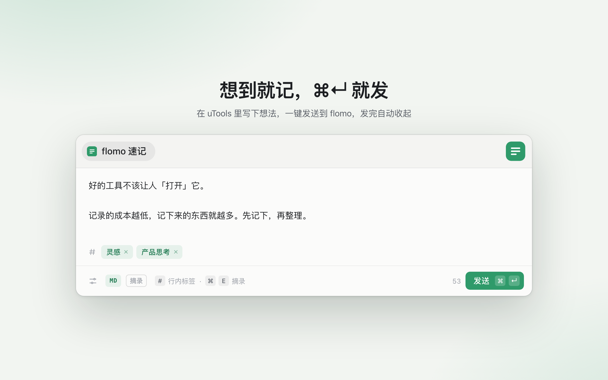
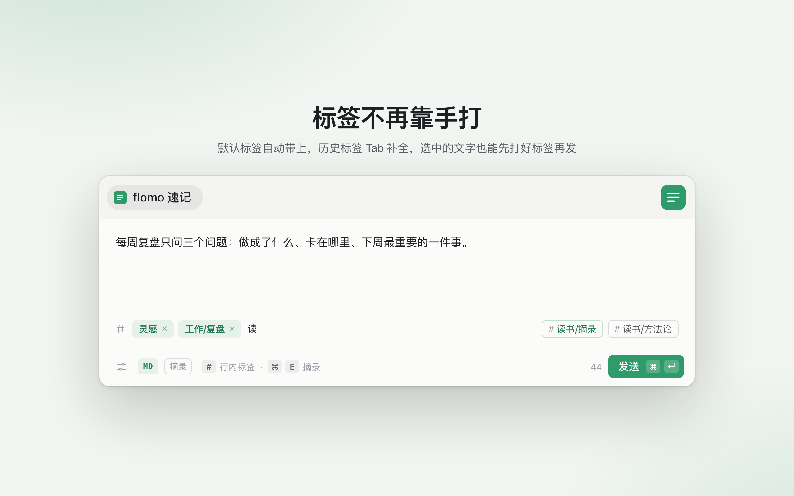
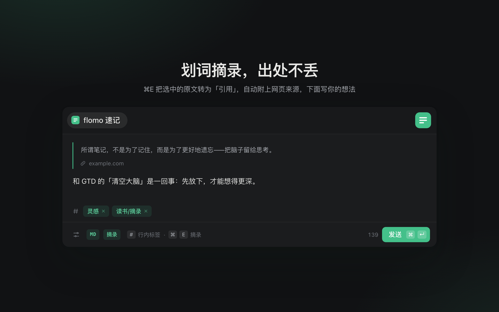
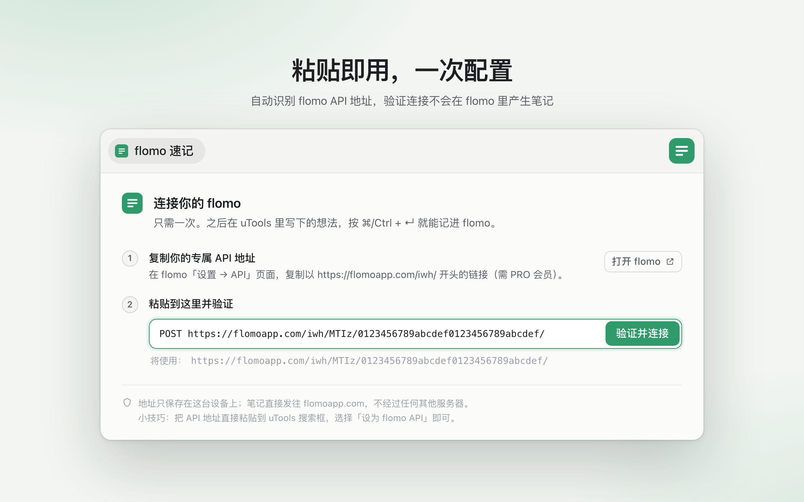
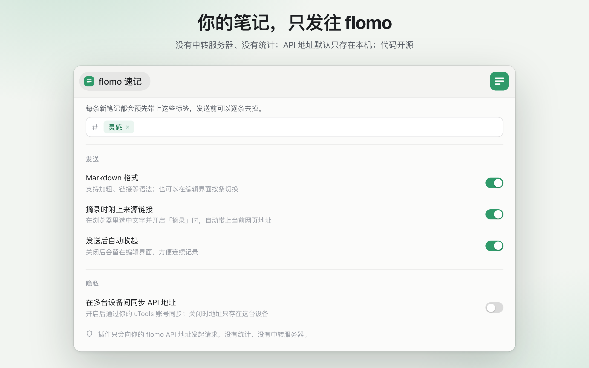

# flomo 速记 · uTools plugin

> 在 uTools 里随手记到 flomo：选标签、⌘/Ctrl + Enter 发送、选中文字一键转为带出处的摘录。

A small, keyboard-first [uTools](https://www.u-tools.cn) plugin that sends notes to [flomo](https://flomoapp.com) through flomo's official **PRO webhook API**. No cookies, no relay server — your note goes straight from your machine to `flomoapp.com`.



## Why

This plugin started from the comment section of an older flomo plugin. The same complaints came up again and again:

| What people said | What this plugin does |
| --- | --- |
| "My API never saves — I paste it, nothing happens, it asks again" | Guided setup that accepts whatever you paste (bare URL, the `POST https://…` line, quoted URL), verifies it **without creating a memo**, and shows flomo's actual error message |
| "Please add default tags" / "let me tag selected text" | Default tags pre-filled on every note, tag autocomplete from your history, `#inline` tags still work |
| "I still have to reach for the mouse to click send" | `⌘/Ctrl + Enter` sends; the panel closes itself afterwards (optional) |
| "I want to keep the original quote *and* my thoughts" | `⌘/Ctrl + E` turns the text into a 「quote」 with the browser page it came from, leaving the editor for your own thoughts |
| "How do I know my API isn't being uploaded somewhere?" | Open source; the only network call is to your flomo webhook; the API URL is stored on this device unless you opt in to uTools sync |
| "I lost what I typed" | Drafts are saved as you type and survive failed sends |

## Screenshots

| Tags | Excerpt | Setup | Privacy |
| --- | --- | --- | --- |
|  |  |  |  |

## Usage

| Do this in uTools | Result |
| --- | --- |
| Search `flomo` → **flomo 速记** (aliases: `记到 flomo`, `浮墨`) | Open the composer; an unsent draft is restored |
| Type or select any text → **记到 flomo** | Open the composer with that text |
| Paste your flomo API URL into the search box → **设为 flomo API** | Jump straight to verify-and-save |

Inside the composer:

| Key | Action |
| --- | --- |
| `⌘/Ctrl + Enter` | Send |
| `⌘/Ctrl + E` | Toggle 摘录 (excerpt): quote + source link |
| `⌘/Ctrl + ,` | Settings |
| `Tab` in the tag field | Accept the first suggestion |
| `Backspace` in an empty tag field | Remove the last tag |

### What gets sent

```text
「quoted text」            ← only in excerpt mode

your thoughts, **markdown** works

[example.com](https://…)  ← source link, excerpt mode only

#default #tags
```

flomo's markdown renders bold and links but drops `>` blockquotes, which is why excerpts use corner brackets.

## Requirements

- A **flomo PRO** account (the webhook API is a PRO feature). Get your URL at flomo → 设置 → API.
- uTools **8.x** (primary target). uTools **7.x** is supported through runtime fallbacks; see [Compatibility](#compatibility).

## Install from source

```bash
git clone git@github.com:Leezj9671/utools-flomo.git
cd utools-flomo
npm install
npm run dev        # serves the UI on http://127.0.0.1:5173 (port is fixed)
```

Then in the **uTools 开发者工具** plugin:

1. 新建项目, then point the project at `public/plugin.json` (do not generate a new React/Vue template).
2. Click **安装（开发模式）** and enable **退出到后台立即结束运行** so code changes are picked up.
3. Type `flomo` in uTools.

For a standalone build, run `npm run build` and package `dist/` (`dist/plugin.json`) with the developer tool.

## Development

```bash
npm run dev      # Vite dev server with HMR
npm test         # unit tests for the flomo client (offline)
FLOMO_API=https://flomoapp.com/iwh/… npm test   # also runs a live check that creates no memo
npm run build    # typecheck + production build into dist/
npm run logo     # regenerate public/logo.png
npm run shots    # regenerate market screenshots in docs/store/ (needs npm run dev)
```

- **Browser preview**: opening `http://127.0.0.1:5173` outside uTools installs a mock runtime (`src/lib/platform.ts`) so the UI can be developed and screenshotted. Query params drive it: `?payload=…`, `?code=setup`, `?noapi=1`, `?fail=invalid_api`, `?dark=1`, `?reset=1`. Add `?stage&title=…&sub=…` for the captioned 1280×800 layout used by the market screenshots. The mock and frame are dev-only and never ship; they are for visuals and do not prove uTools runtime behaviour.
- **Runtime errors in uTools**: in dev mode, errors and an environment report (uTools/Chrome version, missing APIs, preload failures) are POSTed to the dev server and appended to `.devlog`, so you can debug without opening DevTools. The UI also shows an error panel instead of a blank window.

## Release

```bash
npm run build
```

`dist/` is the plugin root: `plugin.json` without the `development` entry, no source maps, no dev mock. In the uTools developer tool, point the project at `dist/plugin.json`, test it without the dev server running, then publish from the developer tool. Store copy, release notes and the full checklist live in [docs/store-listing.md](docs/store-listing.md).

## Project layout

```text
public/
  plugin.json        features: write (text + "记到 flomo" match), setup (API URL regex)
  preload.js         window.services bridge — Node/Electron side
  lib/flomo.js       webhook client: parse URL, verify, send (Node https)
src/
  App.tsx            view routing, plugin-enter handling, panel height
  components/        Composer, TagInput, Onboarding, SettingsView, ApiField, …
  lib/compose.ts     editor state → memo text
  lib/store.ts       settings (synced), API URL (local), drafts
  lib/platform.ts    uTools runtime or browser mock
scripts/             tests and logo generator
```

## Compatibility

| | uTools 8.x | uTools 7.x |
| --- | --- | --- |
| Panel height | `setExpandHeight` | `setExpendHeight` (detected at runtime) |
| API URL storage | `getPluginLocalDataPath()` | OS app-data dir, e.g. `~/Library/Application Support/utools-flomo/` |
| Network | Node `https` | Node `https` (Electron 22 has no global `fetch` in Node) |
| Build target | Chrome 108+ | Chrome 108 |

## Privacy

- Requests go only to the flomo webhook URL you configure.
- The URL is written to a local file with `0600` permissions. Turning on 「在多台设备间同步 API 地址」 additionally stores it in uTools' synced database.
- Settings, default tags and tag history live in uTools' synced database; drafts stay in local storage.

## License

[MIT](LICENSE)

## Credits

Built against the official [uTools developer docs](https://www.u-tools.cn/docs/) and the [utools-plugin-dev skill](https://github.com/uTools-Labs/utools-plugin-dev-skill). Not affiliated with flomo or uTools.
